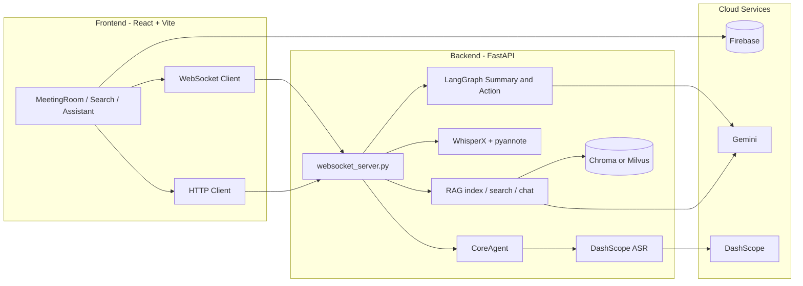
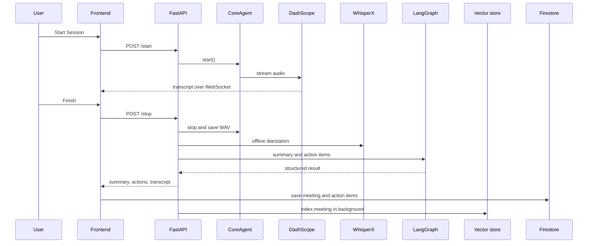

# MeetMind - AI-Powered Meeting Assistant

Real-time meeting transcription, post-meeting understanding, and knowledge retrieval.

会中用 DashScope 做低延迟转写；停录后用 WhisperX 分离说话人，再用 LangGraph 并行生成摘要和待办，并把会议与 PDF 写入向量库，供全局搜索和带引用的问答。

## 项目结构

```
MeetMind-Unified/
├── backend/                 # FastAPI + WebSocket
│   ├── requirements.txt
│   ├── .env.example
│   └── src/
│       ├── agents/          # 会中 CoreAgent，会后 Summary / Action
│       ├── api/             # RAG 与对话路由
│       ├── diarization/     # WhisperX + pyannote
│       ├── graph/           # LangGraph 会后流水线
│       └── rag/             # 分块、嵌入、检索、问答
├── frontend/                # React Web 应用
├── docs/
│   ├── rag-design.md
│   └── diarization-whisperx.md
├── start.sh
├── stop.sh
└── README.md
```

## 功能特性

### 会中

- 实时语音识别（DashScope Paraformer）
- WebSocket 推送转写
- PDF 上传后抽取术语，注入 ASR 热词
- 转写片段可点击翻译为英文

### 会后

- 停录时把会议音频存成 WAV
- WhisperX + pyannote 离线说话人分离；未安装或未配置时沿用会中转写
- LangGraph 并行生成结构化摘要和行动项
- 有 `owner_uid` 和 `project_id` 时，后台把会议写入知识库

### 知识检索（RAG）

- 会议转写、结构化摘要、科研 PDF 分块后写入向量库（默认 Chroma，可切 Milvus）
- 语义分块，检索时向量与关键词混合
- `GlobalSearch`、项目助手和 Assistant 走后端问答，回答带 citation
- 设计细节见 [docs/rag-design.md](docs/rag-design.md)，分离流程见 [docs/diarization-whisperx.md](docs/diarization-whisperx.md)

### 前端

- 实时转录、项目管理、任务列表
- Firebase Auth、Firestore、Storage
- 全局搜索与带引用的项目问答

## 系统架构图



## 编排说明

- **会中编排中心**：`CoreAgent`。它拉起语音识别、会议记录和会中分析。
- **会后编排**：`POST /stop` 先落盘音频并做离线分离，再跑 LangGraph（摘要与行动项并行），最后异步索引 RAG。
- **关键流程**：
	1. 前端点击开始，调用 `POST /start`
	2. 后端打开麦克风并连接 DashScope，转写经 WebSocket 推到前端
	3. 前端点击结束，调用 `POST /stop`，并带上 `project_id`、`meeting_id`、`owner_uid`
	4. 后端返回 summary、结构化摘要、action items、转写，以及分离元数据
	5. 前端把会议和行动项写入 Firestore
	6. 后端在有属主和项目时把同一场会议写入向量库

## 数据流图



## API

| 方法 | 路径 | 作用 |
| --- | --- | --- |
| WS | `/ws` | 实时转写 |
| POST | `/start` | 开始录音 |
| POST | `/stop` | 停录、分离、摘要、待办，并触发会议索引 |
| POST | `/api/diarize` | 对已有 WAV 做离线说话人分离 |
| POST | `/api/chat` | 服务端 Gemini 对话 |
| POST | `/api/rag/search` | 知识库检索 |
| POST | `/api/rag/chat` | 带 citation 的问答 |
| POST | `/api/rag/index/meeting` | 手动索引一场会议 |
| POST | `/api/rag/index/pdf` | 索引已抽取的 PDF 文本 |
| POST | `/api/rag/index/pdf-file` | 上传并索引科研 PDF |
| POST | `/upload-pdf` | 抽取术语并注入 ASR 热词 |
| GET | `/status` | 当前录音状态 |

`POST /stop` 的请求体：

```json
{
  "project_id": "proj-id",
  "meeting_id": "mtg-id",
  "owner_uid": "firebase-uid",
  "meeting_title": "Weekly sync"
}
```

检索和问答都要求 `owner_uid`。按项目过滤时再传 `project_id`。

## 快速开始

### 环境要求

- **Python**: 3.10+
- **Node.js**: 18+
- **系统**: macOS / Linux / Windows

### 1. 配置环境变量

复制示例后填入自己的密钥：

```bash
cp backend/.env.example backend/.env
cp frontend/.env.example frontend/.env
```

后端至少需要：

```bash
GEMINI_API_KEY=your_gemini_api_key_here
GEMINI_MODEL_NAME=gemini-3.6-flash
DASHSCOPE_API_KEY=your_dashscope_api_key
DASHSCOPE_ASR_MODEL_NAME=paraformer-realtime-v2

# RAG，默认 Chroma + 语义分块
RAG_EMBEDDING_MODEL=gemini-embedding-001
RAG_VECTOR_STORE=chroma
RAG_CHUNK_STRATEGY=semantic

# 会后分离。重依赖默认不装，见下方可选项
MEETING_AUDIO_PERSIST=true
DIARIZATION_OFFLINE_ENABLED=true
HF_TOKEN=your_huggingface_token
```

前端：

```bash
VITE_API_URL=http://localhost:8765
VITE_GEMINI_API_KEY=your_gemini_api_key_here

VITE_FIREBASE_PROJECT_ID=your-project-id
VITE_FIREBASE_APP_ID=your-app-id
VITE_FIREBASE_API_KEY=your-firebase-api-key
VITE_FIREBASE_AUTH_DOMAIN=your-project.firebaseapp.com
VITE_FIREBASE_FIRESTORE_DATABASE_ID=your-database-id
VITE_FIREBASE_STORAGE_BUCKET=your-project.firebasestorage.app
VITE_FIREBASE_MESSAGING_SENDER_ID=your-sender-id
```

Gemini 的会议摘要、行动项和 RAG 问答只在后端调用。前端的 `VITE_GEMINI_API_KEY` 只用于转写片段的点击翻译。

### 2. 安装依赖

```bash
cd backend
python -m venv .venv
source .venv/bin/activate  # Windows: .venv\Scripts\activate
pip install -r requirements.txt
```

说话人分离是可选项，模型较大：

```bash
pip install whisperx pyannote.audio
```

使用 pyannote 前，需要在 Hugging Face 接受 `pyannote/speaker-diarization-3.1` 的条款，并把 Access Token 写到 `HF_TOKEN`。未安装或没有 token 时，停录仍会生成摘要，只是跳过离线分离或只做对齐。

```bash
cd frontend
npm install
```

### 3. 启动项目

```bash
./start.sh
```

或分开启动：

```bash
cd backend && source .venv/bin/activate && python src/websocket_server.py
cd frontend && npm run dev
```

### 4. 访问应用

- **前端**: http://localhost:3000
- **后端 API**: http://localhost:8765
- **WebSocket**: ws://localhost:8765/ws

## 停止服务

```bash
./stop.sh
```

## 使用说明

1. 使用 Google 账号登录
2. 在 Dashboard 创建会议项目
3. 进入 Meeting Room，开始录音并查看实时转写；需要英文时点击 Translate
4. 结束会议后，后端生成摘要和待办，前端写入 Firestore，并在有属主时索引这场会议
5. 在项目页上传 PDF，文件会进入知识库
6. 在全局搜索或项目助手里提问，回答会带上来源片段

## 技术栈

### 后端

- FastAPI, Uvicorn
- DashScope ASR, Google Gemini
- LangChain, LangGraph
- Chroma 或 Milvus，可选 Chinese-CLIP
- 可选 WhisperX 与 pyannote

### 前端

- React 19, TypeScript, Vite
- TailwindCSS, Motion
- Firebase Auth / Firestore / Storage

## 开发者：张典

- **项目**: MeetMind
- **类型**: Full-stack Meeting Assistant
- **许可**: MIT

## 故障排除

### 后端无法启动

- 确认虚拟环境已激活，并且 `pip install -r requirements.txt` 已完成
- 检查 `backend/.env` 里的 `DASHSCOPE_API_KEY` 和 `GEMINI_API_KEY`
- 确认端口 8765 没有被占用

### 停录后没有说话人分离

- `DIARIZATION_OFFLINE_ENABLED` 需要为 true，并且停录时生成了 WAV
- 安装 `whisperx` 与 `pyannote.audio`，配置 `HF_TOKEN`
- 缺少这些条件时，接口仍返回会中 DashScope 转写

### RAG 没有结果

- 停录请求要带 `owner_uid` 和 `project_id`，检索也要带同一个 `owner_uid`
- 确认 Gemini embedding 可用，向量库目录 `backend/data/chroma` 可写

### 前端白屏或 WebSocket 失败

- 检查 Firebase 配置和 `VITE_API_URL`
- 先启动后端，再打开 `ws://localhost:8765/ws`

## 更新日志

### v1.1.0 (2026-11-13)

- 会后 LangGraph 流水线：结构化摘要与行动项
- WhisperX + pyannote 离线说话人分离，停录音频落盘
- RAG：会议与 PDF 索引、混合检索、带 citation 的问答
- 新增 `/api/rag/*`、`/api/chat`、`/api/diarize`

### v1.0.0 (2026-05-09)

- 初始版本发布
- 前后端统一，实时转写与点击翻译
